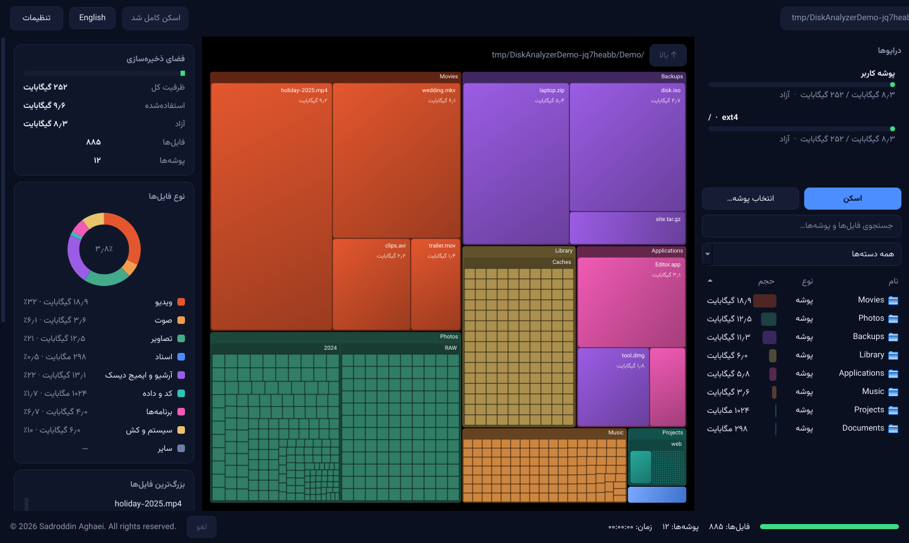
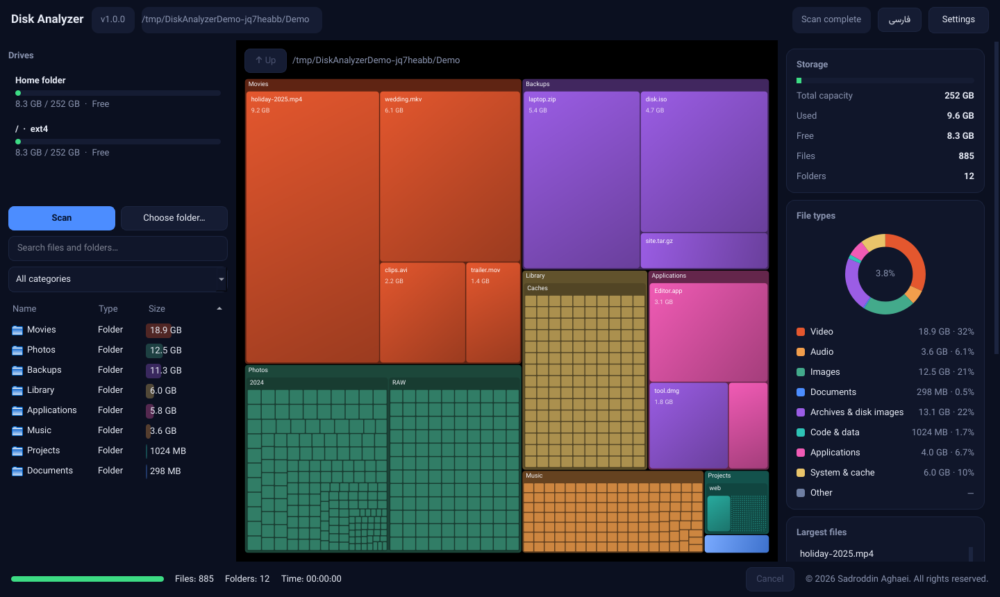

<div align="center">


# Disk Analyzer · دیسک آنالایزر

**فارسی** | [English](#english)

[](../../actions/workflows/ci.yml)
[](../../actions/workflows/tests.yml)
[](../../actions/workflows/release.yml)

</div>

---

<div dir="rtl">

## فارسی

**دیسک آنالایزر** یک برنامه‌ی دسکتاپ چندسکویی برای دیدن این است که فضای دیسک شما صرف چه چیزی شده است. نتیجه‌ی اسکن به‌صورت یک **نقشه‌ی درختی (Treemap) رنگی و تعاملی** نمایش داده می‌شود؛ با رابط مشکی OLED، پشتیبانی کامل از **راست‌به‌چپ (RTL) و فونت وزیرمتن**، و نسخه‌ی انگلیسی.

> دیسک آنالایزر **فقط‌خواندنی** است: هرگز فایلی را تغییر نمی‌دهد، جابه‌جا یا حذف نمی‌کند، به مدیر سیستم (Administrator) نیاز ندارد و نام یا مسیر فایل‌ها را به هیچ سرویسی ارسال نمی‌کند. همه‌چیز محلی است.

### تصاویر

| فارسی (RTL) | English (LTR) |
|---|---|
|  |  |

<sub>تصاویر از خود برنامه (رندر آفلاین) با داده‌ی نمونه‌ی ساختگی گرفته شده‌اند.</sub>

### امکانات

- تشخیص خودکار درایوها و نمایش ظرفیت، فضای استفاده‌شده و آزاد
- اسکن بازگشتی روی نخ پس‌زمینه (رابط قفل نمی‌شود)، با نوار پیشرفت، شمارنده‌ی فایل/پوشه، زمان سپری‌شده و **دکمه‌ی لغو**
- نقشه‌ی درختی تعاملی: رنگ بر اساس نوع فایل، اطلاعات هنگام حرکت ماوس، کلیک برای ورود به پوشه
- بزرگ‌ترین فایل‌ها و پوشه‌ها، دسته‌بندی نوع فایل (ویدیو، صوت، تصویر، اسناد، آرشیو، کد، برنامه، سیستم…)
- جستجو و فیلتر بر اساس نام و دسته، مرتب‌سازی بر اساس حجم، نام و نوع
- خروجی **CSV** (سازگار با Excel و نام‌های فارسی) و **JSON**
- مدیریت خطای دسترسی (پوشه‌های غیرقابل‌خواندن رد می‌شوند و گزارش می‌شوند)
- محافظت در برابر حلقه‌ی لینک‌های نمادین (symlink / junction دنبال نمی‌شوند)
- مصرف حافظه‌ی محدود: برای هر پوشه فقط بزرگ‌ترین فایل‌ها نگه داشته می‌شوند و بقیه در یک گره‌ی تجمیعی با حجم دقیق ادغام می‌شوند
- فارسی (پیش‌فرض، RTL) و انگلیسی با سیستم ترجمه‌ی متمرکز

### سیستم‌عامل‌های پشتیبانی‌شده

| سیستم‌عامل | معماری | قالب بسته |
|---|---|---|
| Windows 10 / 11 | Intel/AMD 64-bit (x64) | ZIP |
| Windows 11 | ARM64 (بومی) | ZIP |
| macOS 13+ | Apple Silicon (M1 و جدیدتر) | DMG |
| macOS 13+ | Intel (x86_64) | DMG |

### دانلود

از بخش **[Releases](../../releases/latest)** فایل مناسب سیستم خود را بگیرید:

| سیستم شما | فایل |
|---|---|
| ویندوز ۱۰/۱۱ — اینتل/AMD | `Disk-Analyzer-vX.Y.Z-Windows-x64.zip` |
| ویندوز ۱۱ — ARM64 | `Disk-Analyzer-vX.Y.Z-Windows-ARM64.zip` |
| مک — Apple Silicon | `Disk-Analyzer-vX.Y.Z-macOS-Apple-Silicon-arm64.dmg` |
| مک — اینتل | `Disk-Analyzer-vX.Y.Z-macOS-Intel-x86_64.dmg` |
| صحت فایل‌ها | `Disk-Analyzer-vX.Y.Z-SHA256SUMS.txt` |

### نصب

- **ویندوز:** ZIP را کامل استخراج کنید و `DiskAnalyzer.exe` را اجرا کنید. نیازی به نصب پایتون نیست.
- **مک:** DMG را باز کنید و برنامه را به Applications بکشید.

> ⚠️ **نسخه‌ها امضای دیجیتال ندارند و نسخه‌های macOS توسط اپل Notarize نشده‌اند.** بار اول، ویندوز (SmartScreen) یا macOS (Gatekeeper) هشدار می‌دهند. در مک روی برنامه راست‌کلیک ← Open؛ در ویندوز More info ← Run anyway. جزئیات در فایل `INSTALL.txt` داخل هر بسته است. پشتیبانی از امضا و Notarization به‌عنوان تنظیم اختیاری در آینده در نظر گرفته شده است (متغیر `CODESIGN_IDENTITY`).

با فایل SHA256SUMS صحت دانلود را بررسی کنید:

```bash
shasum -a 256 -c Disk-Analyzer-vX.Y.Z-SHA256SUMS.txt      # macOS / Linux
certutil -hashfile Disk-Analyzer-vX.Y.Z-Windows-x64.zip SHA256   # Windows
```

### راهنمای استفاده

1. از فهرست **درایوها** یک درایو (یا «پوشه کاربر») را انتخاب کنید، یا با «انتخاب پوشه…» پوشه‌ی دلخواه را برگزینید.
2. «اسکن» را بزنید. هر زمان خواستید «لغو» را بزنید.
3. روی مستطیل‌های نقشه کلیک کنید تا وارد آن پوشه شوید؛ با «بالا» برگردید. ماوس را روی هر مستطیل نگه دارید تا نام، حجم و درصد را ببینید.
4. از کادر جستجو و فیلتر دسته‌ها برای یافتن فایل استفاده کنید؛ روی ستون‌ها کلیک کنید تا مرتب شوند.
5. از **تنظیمات ← خروجی CSV / JSON** نتیجه را ذخیره کنید. زبان را از دکمه‌ی بالای صفحه یا منوی تنظیمات عوض کنید.

**نکته‌ی macOS:** برای اسکن پوشه‌های محافظت‌شده یا کل دیسک، در System Settings ← Privacy & Security دسترسی *Full Disk Access* بدهید.
**نکته:** اسکن به‌صورت پیش‌فرض در محدوده‌ی همان فایل‌سیستم می‌ماند و روی دیسک‌های سوار‌شده‌ی دیگر یا `/proc` نمی‌رود.

### ساخت از سورس

نیازمندی: Python 3.12 یا جدیدتر.

```bash
python -m venv .venv && source .venv/bin/activate      # ویندوز: .venv\Scripts\activate
pip install -r requirements-dev.txt
python main.py                                          # اجرای برنامه
python -m pytest                                        # تست‌ها
ruff check . && ruff format --check . && mypy .         # کیفیت کد
```

ساخت بسته (باید روی سیستم‌عامل و معماری هدف اجرا شود؛ اسکریپت‌ها در صورت ناسازگاری معماری متوقف می‌شوند):

```bash
python scripts/build_windows.py --version 1.0.0 --arch x64     # یا arm64 ← خروجی در release/
python scripts/build_macos.py   --version 1.0.0 --arch arm64   # یا x64   ← خروجی در release/
python scripts/verify_artifacts.py windows --zip release/<file>.zip --arch x64
```

### انتشار خودکار (GitHub Actions)

```bash
git tag v1.0.0
git push origin v1.0.0
```

این کار `release.yml` را اجرا می‌کند: اعتبارسنجی SemVer ← ساخت **بومی** روی چهار runner ← بررسی معماری واقعی باینری‌ها و اجرای تست دود ← تولید SHA256 ← ساخت GitHub Release با هر چهار بسته. اگر هر یک از بیلدها شکست بخورد، Release منتشر **نمی‌شود**. همچنین می‌توان workflow را دستی با ورودی نسخه اجرا کرد. جزئیات: [`docs/DEPLOYMENT.md`](docs/DEPLOYMENT.md).

### مشارکت

Pull Request ها خوشامدند. قبل از ارسال: `ruff check .`، `ruff format .`، `mypy .` و `python -m pytest` را اجرا کنید. رشته‌های رابط کاربری را **فقط** در `app/localization.py` (هر دو زبان) اضافه کنید؛ تست‌ها یکسان بودن کلیدها را بررسی می‌کنند. هیچ تغییری نباید به برنامه قابلیت نوشتن/حذف فایل کاربر اضافه کند.

### مجوز و کپی‌رایت

مجوز MIT — فایل [`LICENSE`](LICENSE). اجزای شخص‌ثالث: [`THIRD-PARTY-NOTICES.txt`](THIRD-PARTY-NOTICES.txt) (Qt/PySide6 تحت LGPL، فونت وزیرمتن تحت OFL).

© 2026 Sadroddin Aghaei. All rights reserved.

</div>

---

## English

**Disk Analyzer** is a cross-platform desktop app that shows what is using your disk space. Scan results appear as a colourful, interactive **treemap** in a pure-black OLED interface with full **Persian RTL support (Vazirmatn font)** and an English UI.

> Disk Analyzer is **read-only**: it never modifies, moves or deletes files, never asks for administrator rights, and never sends file names or paths anywhere. Everything stays local.

### Screenshots

| Persian (RTL) | English (LTR) |
|---|---|
|  |  |

<sub>Rendered offscreen from the real application using synthetic demo data.</sub>

### Features

- Automatic drive detection with capacity / used / free
- Recursive scan on a background thread (the UI never freezes) with progress, counters, elapsed time and **cancel**
- Interactive treemap: colour per file category, hover details, click to drill down
- Largest files and folders, file-type breakdown (video, audio, images, documents, archives, code, apps, system…)
- Search and category filter, sorting by size, name and type
- **CSV** (Excel-friendly, Persian names safe, formula-injection safe) and **JSON** export
- Permission errors are recorded and skipped, never fatal
- Symlink / junction recursion protection (links are not followed)
- Bounded memory: each folder keeps its largest files and folds the rest into one aggregate node with exact byte totals
- Persian (default, RTL) and English via a centralised localisation system

### Supported platforms

| OS | Architecture | Package |
|---|---|---|
| Windows 10 / 11 | Intel/AMD 64-bit (x64) | ZIP |
| Windows 11 | ARM64 (native) | ZIP |
| macOS 13+ | Apple Silicon (M1 and newer) | DMG |
| macOS 13+ | Intel (x86_64) | DMG |

### Download

Get the file for your system from **[Releases](../../releases/latest)**:

| Your system | File |
|---|---|
| Windows 10/11 — Intel/AMD | `Disk-Analyzer-vX.Y.Z-Windows-x64.zip` |
| Windows 11 — ARM64 | `Disk-Analyzer-vX.Y.Z-Windows-ARM64.zip` |
| macOS — Apple Silicon | `Disk-Analyzer-vX.Y.Z-macOS-Apple-Silicon-arm64.dmg` |
| macOS — Intel | `Disk-Analyzer-vX.Y.Z-macOS-Intel-x86_64.dmg` |
| Checksums | `Disk-Analyzer-vX.Y.Z-SHA256SUMS.txt` |

### Installation

- **Windows:** extract the whole ZIP and run `DiskAnalyzer.exe`. No Python needed.
- **macOS:** open the DMG and drag the app to Applications.

> ⚠️ **Builds are not code-signed and the macOS builds are not notarized.** Windows SmartScreen / macOS Gatekeeper will warn on first launch. macOS: right-click → Open. Windows: More info → Run anyway. See `INSTALL.txt` inside each package. Signing/notarization is prepared as an optional future configuration (`CODESIGN_IDENTITY`).

### Usage

1. Pick a drive (or "Home folder") in **Drives**, or use **Choose folder…**.
2. Press **Scan** (press **Cancel** any time).
3. Click treemap tiles to drill into folders; use **Up** to go back. Hover a tile for name, size and share.
4. Use search and the category filter; click column headers to sort.
5. **Settings → Export CSV / JSON** to save results. Switch language with the header button or Settings menu.

macOS: grant *Full Disk Access* (System Settings → Privacy & Security) to scan protected folders or the whole disk. By default a scan stays on the starting filesystem (it will not descend into other mounts or `/proc`).

### Build from source

Requires Python 3.12+.

```bash
python -m venv .venv && source .venv/bin/activate      # Windows: .venv\Scripts\activate
pip install -r requirements-dev.txt
python main.py                                          # run the app
python -m pytest                                        # tests
ruff check . && ruff format --check . && mypy .         # quality gates
```

Packaging must run on the target OS *and* architecture (the scripts abort on a mismatch):

```bash
python scripts/build_windows.py --version 1.0.0 --arch x64     # or arm64 → release/
python scripts/build_macos.py   --version 1.0.0 --arch arm64   # or x64   → release/
python scripts/verify_artifacts.py windows --zip release/<file>.zip --arch x64
```

### Automated releases (GitHub Actions)

```bash
git tag v1.0.0
git push origin v1.0.0
```

`release.yml` validates SemVer → builds **natively** on four runners → inspects the real binary architecture and smoke-tests start-up → generates SHA256 sums → creates the GitHub Release with all four packages. If any build fails, **no release is published**. It can also be started manually with a version input. Details: [`docs/DEPLOYMENT.md`](docs/DEPLOYMENT.md).

| Target | Runner | Arch |
|---|---|---|
| Windows x64 | `windows-latest` | x86_64 |
| Windows ARM64 | `windows-11-arm` | ARM64 |
| macOS Apple Silicon | `macos-latest` | arm64 |
| macOS Intel | `macos-15-intel` | x86_64 |

### Contributing

Pull requests are welcome. Before submitting run `ruff check .`, `ruff format .`, `mypy .` and `python -m pytest`. Add UI strings **only** in `app/localization.py` (both languages; tests enforce key parity). Changes must never give the app the ability to write, move or delete user files.

### License & copyright

MIT — see [`LICENSE`](LICENSE). Third-party components: [`THIRD-PARTY-NOTICES.txt`](THIRD-PARTY-NOTICES.txt) (Qt/PySide6 under LGPL, Vazirmatn under OFL).

© 2026 Sadroddin Aghaei. All rights reserved.
